# Overseer
[](LICENSE) [](plugins/overseer/.claude-plugin/plugin.json) [](https://code.claude.com/docs/en/plugins)<br>
Overseer runs your project's `PLAN.md` through the Claude Code sessions you pick. It gives each session a task and judges the finished work against the plan. It keeps a weekly-limit budget. It answers the questions that the sessions wait for and sends a message to each stalled session. It never starts a session.

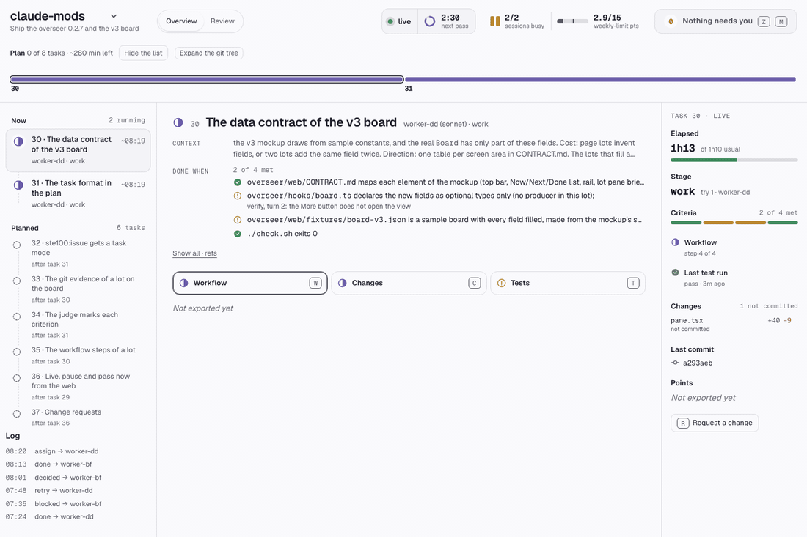

## Features

<table>
  <tr>
    <td width="33%" valign="top">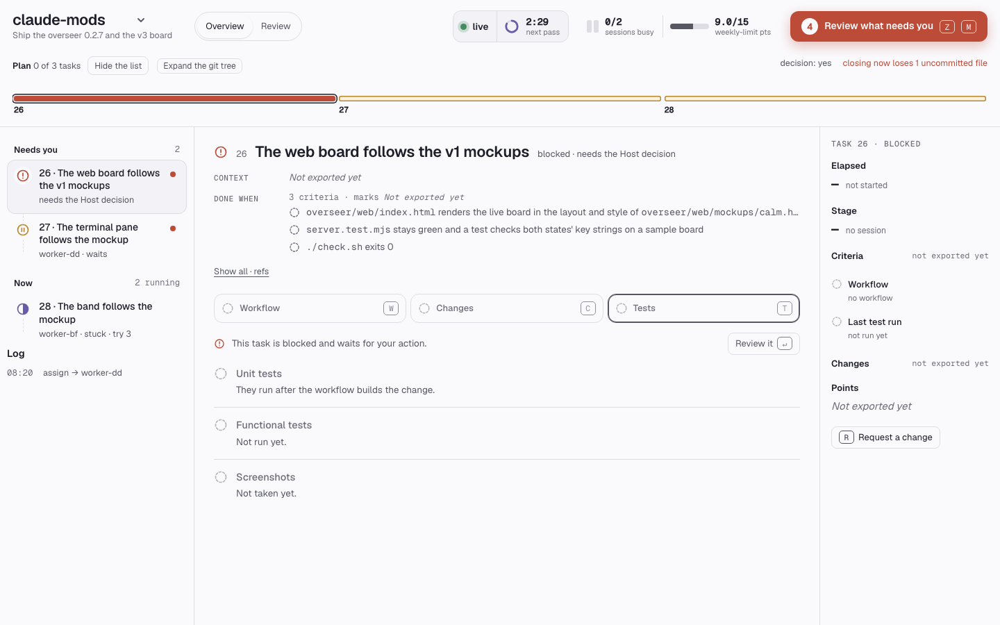<br><b>Needs you</b><br>One list of what waits for you, with the agent's advice.</td>
    <td width="33%" valign="top">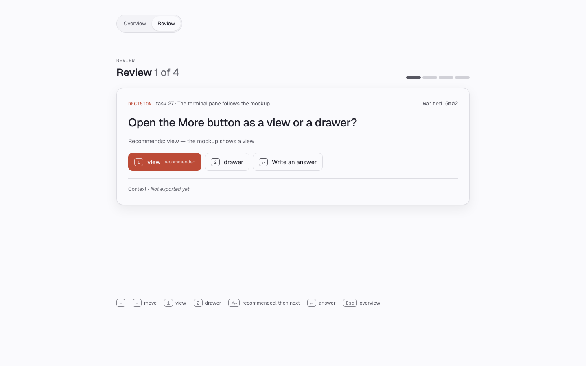<br><b>Zen review</b><br>One card at a time. Answer with one key.</td>
    <td width="33%" valign="top">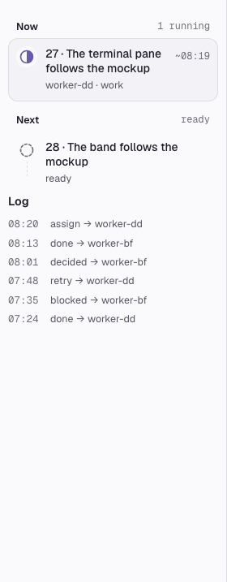<br><b>Log</b><br>See each task the overseer gave, each verdict and each block. You do not have to read the sessions.</td>
  </tr>
  <tr>
    <td width="33%" valign="top">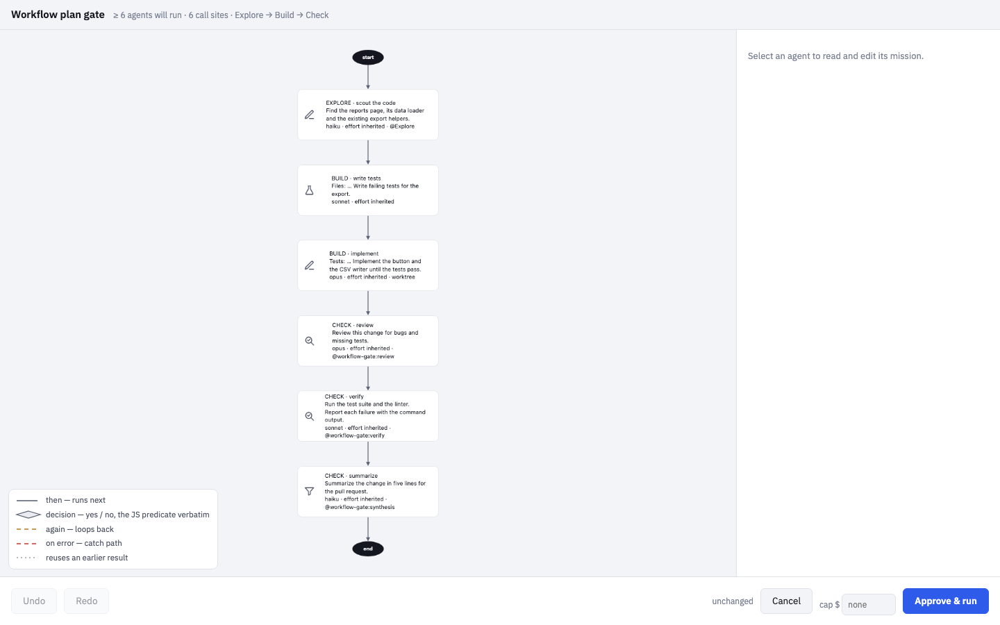<br><b>Workflow gate</b><br>Approve a <code>Workflow</code> plan before it runs.</td>
    <td width="33%" valign="top">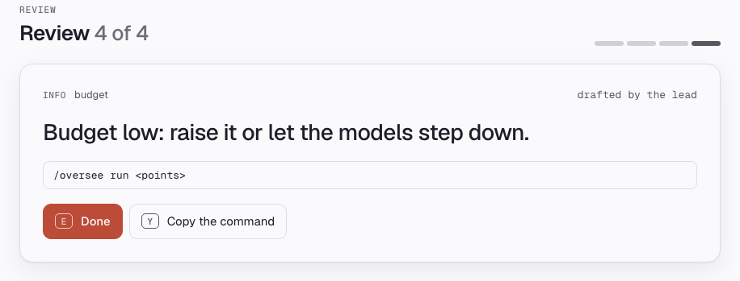<br><b>Budget</b><br>At half of the points you set, the models step down. At the limit, no new task starts.</td>
    <td width="33%" valign="top">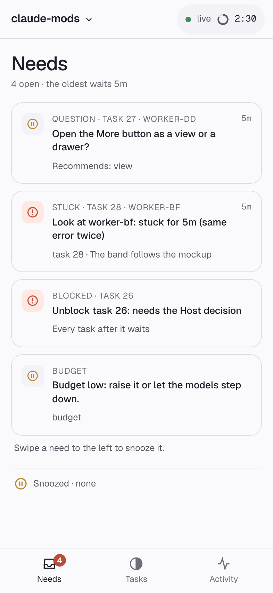<br><b>Phone</b><br>The same board on your phone, with push alerts.</td>
  </tr>
</table>

## Install

```
/plugin marketplace add VictorGjn/overseer
/plugin install overseer@overseer
/plugin install workflow-gate@overseer
```

Node 20+ must be on your `PATH`. The gate hooks run `node`. [TypeSafe](https://typesafe.ai) is optional. Without `TYPESAFE_API_KEY`, the features that use it are off and nothing fails.

## First run

Open Claude Code at the top of a git repository. Overseer reads the `PLAN.md` at the top of the repository. To try the sample, copy it to a repository of its own:

```
cp -r examples/sample-repo ~/sample-repo && cd ~/sample-repo && git init -q && git add -A && git commit -qm sample
```

Then run these commands in Claude Code:

```
/oversee watch self     # pick the sessions to drive (ids come from /oversee)
/oversee plan <goal>    # only if there is no PLAN.md: Claude writes it
/oversee run 15         # run the plan with a budget of 15 weekly-limit points
/oversee show           # open the board
```

A `PLAN.md` has one `## [ ] N. Title` section per task. Each task has a `done when:` line. The lines `check:`, `depends:`, `model:` and `owner:` are optional.

> [!NOTE]
> Overseer never starts or stops a session. It drives the sessions you pick with `/oversee watch`.

## How it works

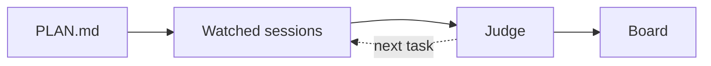

Each free session gets the next task. A session ends its task with a `[task N done on <branch>]` line, or with `[task N blocked: <why>]`. The overseer runs the `check:` command of the task, if there is one. Then the judge model compares the work with the `done when:` line. Every 3 minutes (the default), the overseer reads the sessions again and updates the board.

## The Mac board

<picture>
  <source media="(prefers-color-scheme: dark)" srcset="docs/img/board-dark.png">
  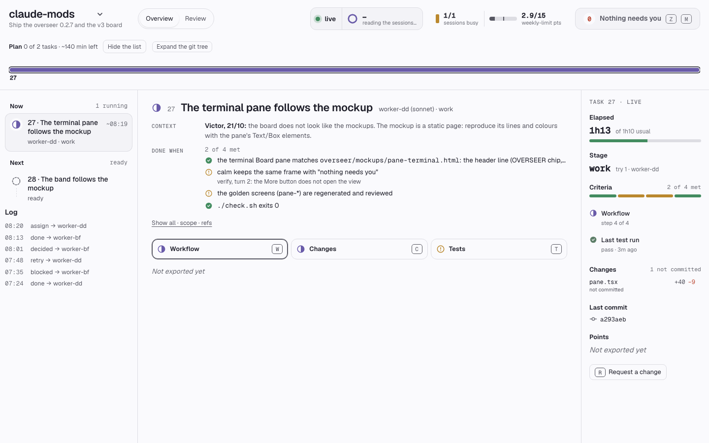
</picture>

- **Plan.** The rail shows each task by its state. The list groups the tasks: Needs you, Now, Next and Planned. Press `G` to open the git tree, with one lane for each branch.
- **Needs you.** One list of the questions, approvals and blocks that wait for you. It shows the agent's advice and what each item blocks.
- **Log.** The log of what the overseer did: each task it gave, each verdict and each block. On the phone, this is the Activity tab.
- **Budget.** Points spent against the budget. At half, the models step down. At the end, no new task starts.

Run `/oversee show` to open the board. The board server listens on `127.0.0.1:4318`. Only your machine can connect to it until you run `/oversee phone`. Each request, except `/version`, must have the board token.

## Zen review

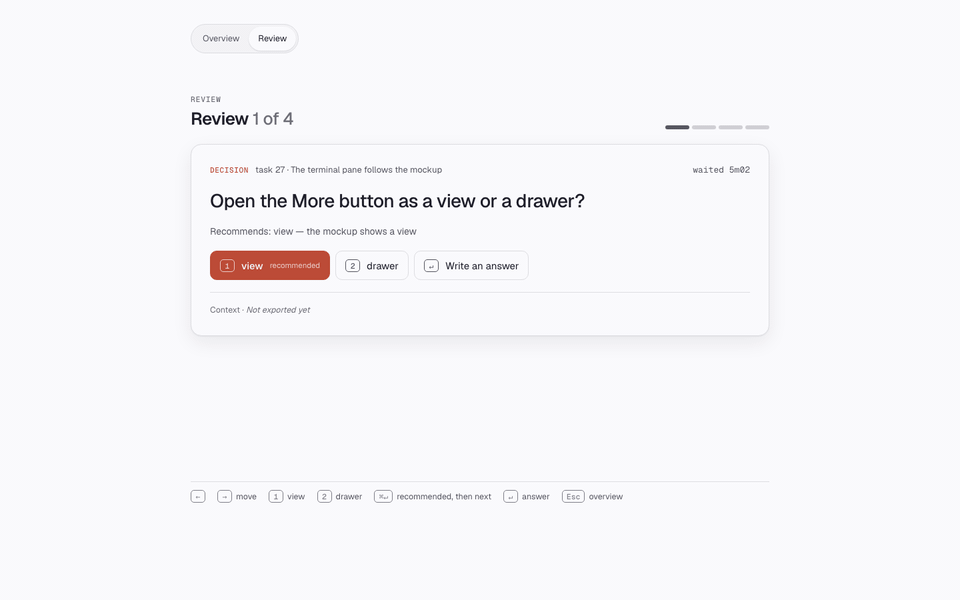

Open the Review view, or press `z` then `m`. The board shows one card at a time. Each option shows its key. Press that key to answer. Press `⌘↵` to choose the recommended option. Press `←` and `→` to move between cards. Press `Esc` to return to the Overview.

## The workflow gate

`workflow-gate` blocks the `Workflow` tool until you approve the exact script. A graph editor shows the plan. You can edit the missions and the model tiers. Then you approve or cancel. If nobody touches the editor for 90 seconds, the gate asks you in the chat. The board can also approve, change or reject the workflow of a watched session.


## The phone

Run `/oversee phone`. Tailscale makes the board available on your phone. Only the devices of your tailnet can connect to it. A QR code appears in a pane. Scan it with the phone camera. Tailscale must run on the phone.

Open the project menu and press **Notify me** to get push alerts for new needs. You can set quiet hours.

> [!TIP]
> The Mac must stay awake. Run `caffeinate -s` in a terminal. Run `/oversee phone off` to stop.

<table>
  <tr>
    <td align="center"><br><b>Needs</b></td>
    <td align="center">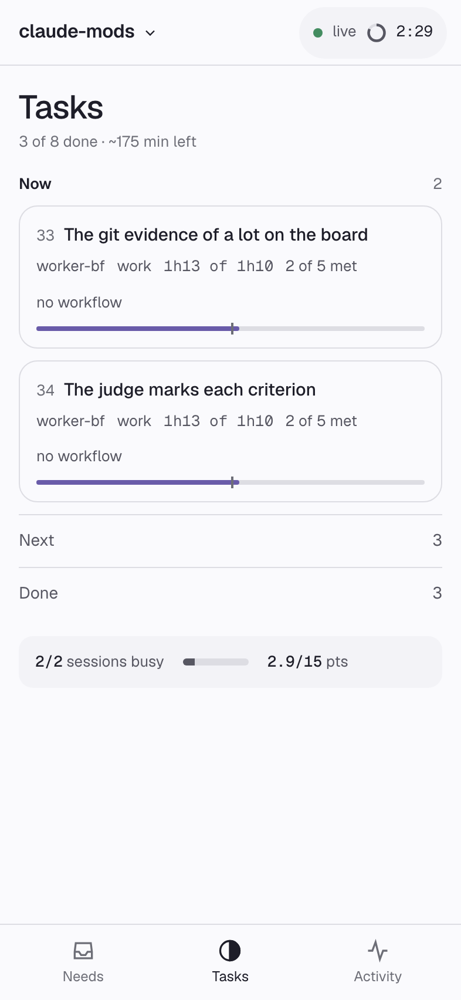<br><b>Tasks</b></td>
    <td align="center">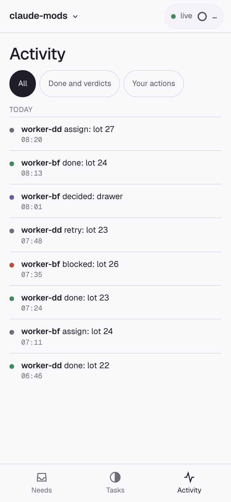<br><b>Activity</b></td>
  </tr>
</table>

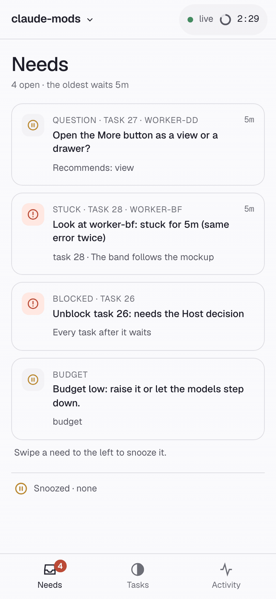

## Commands

<details>
<summary>Every <code>/oversee</code> command</summary>

- `/oversee` lists the sessions active in the last hour.
- `/oversee watch <id>` picks a session to drive. `self` is this session.
- `/oversee drop <id>` releases a session. The overseer does not drive it again.
- `/oversee plan <goal>` asks Claude to write `PLAN.md`.
- `/oversee run [points]` gives each free session the next task. The default budget is 15 points.
- `/oversee status` prints the tasks and the budget as a table.
- `/oversee show` opens the board in the terminal and in the browser.
- `/oversee focus` says the one next action.
- `/oversee merge [go]` tries a merge of each branch and shows the result. `go` gives the merge to a session.
- `/oversee phone` puts the board on your phone. `/oversee phone off` stops it.
- `/oversee log` prints the log.
- `/oversee off` stops the overseer. No session stays watched.

</details>

Planned: chat with a session from the board.

## Troubleshooting

- **The board looks old after an update.** An old board server still runs. Open `http://127.0.0.1:4318/version`. If the version is old, run `/oversee phone`, then `/oversee phone off`. The new plugin replaces the old server at once. `/oversee run` also replaces it, but at most one time in 5 minutes.
- **A session is no longer watched.** The overseer releases a session that ends. Run `/oversee` to find its id. Then run `/oversee watch <id>`.
- **The gate blocks a workflow and you cannot approve it.** Type `override manual approval` as its own chat message. Add `for 2h` to set the time. The default is 8 hours. Type `restore manual approval` to start the gate again.
- **`/oversee run` says there is no weekly-limit reading.** Send any message in the session. Then run `/oversee run` again.

## Development

```
./check.sh                          # validate, test and scan both plugins
node plugins/overseer/web/shots.mjs # make the images in docs/img (needs Chrome and ffmpeg)
```

`./check.sh` also scans for secrets and private data. `OVERSEER_DENYLIST=<file> ./check.sh` scans for the names in that file.

## License

[MIT](LICENSE), copyright 2026 Victor Grosjean.
