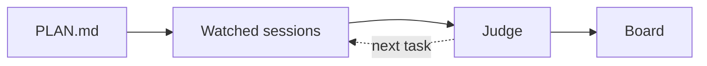
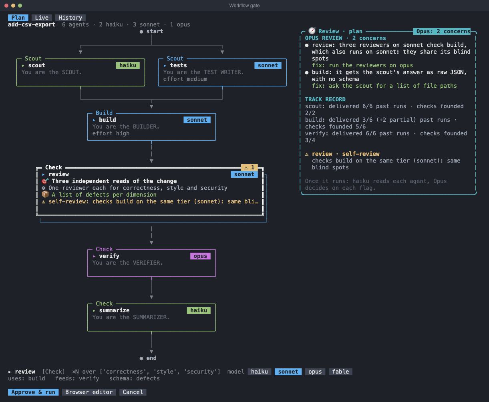
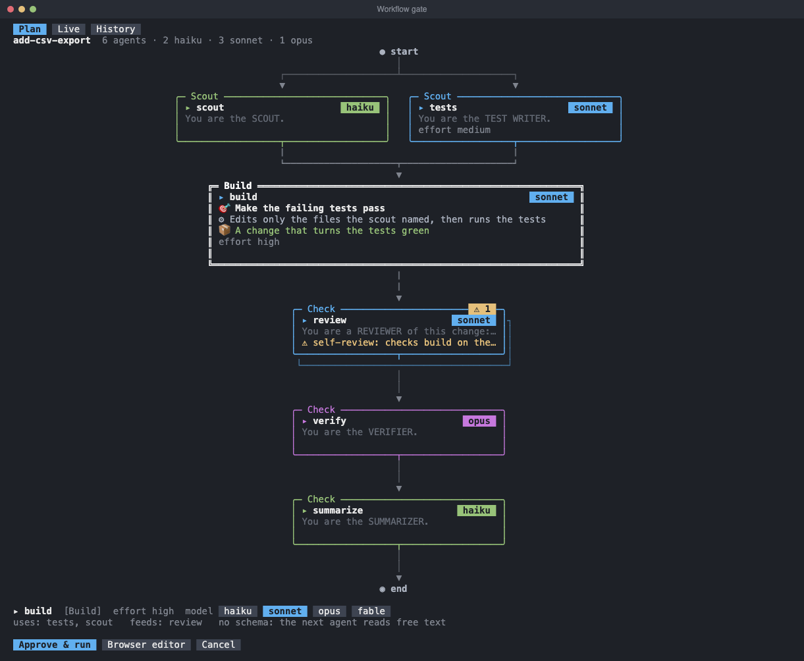
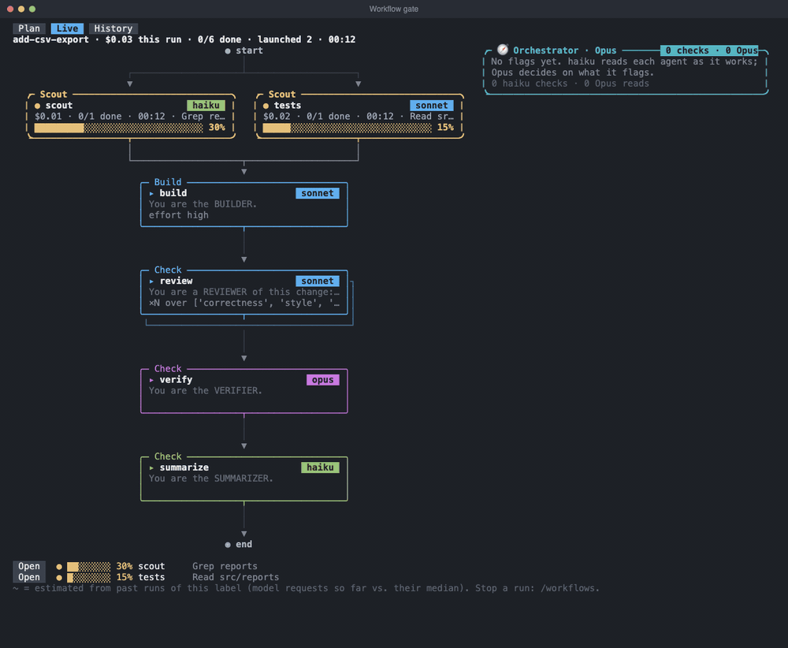
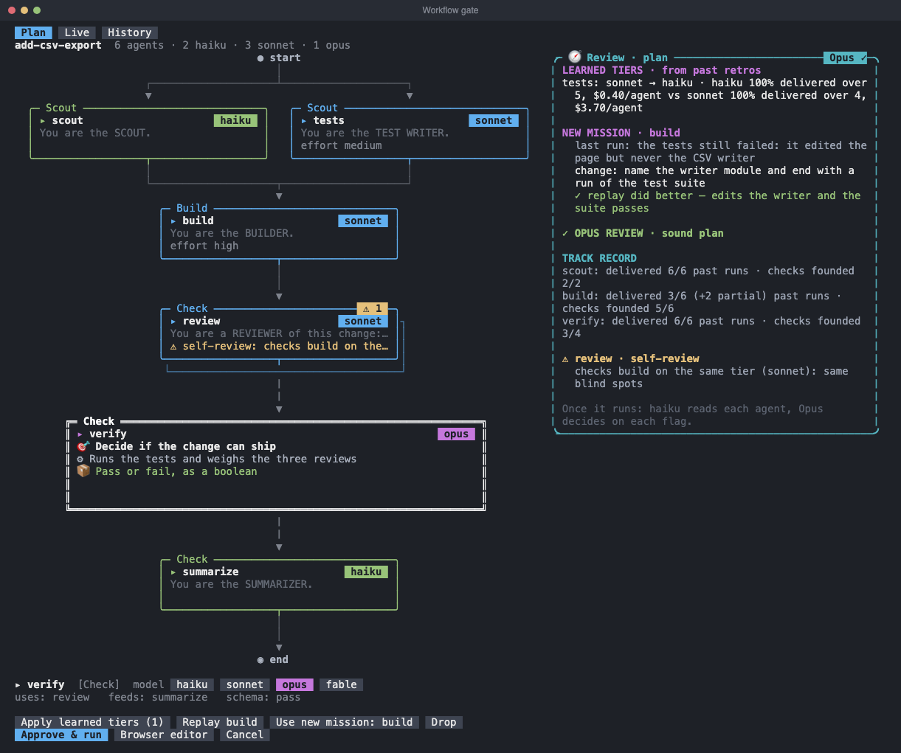
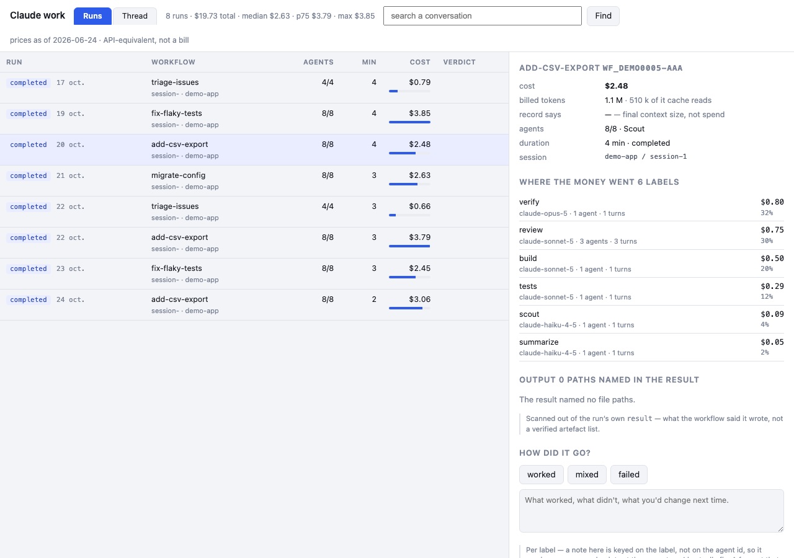
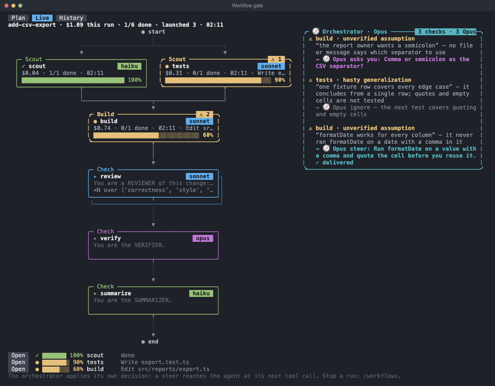

# Overseer and the workflow gate
[](LICENSE) [](plugins/overseer/.claude-plugin/plugin.json) [](plugins/workflow-gate/.claude-plugin/plugin.json) [](plugins/workflow-gate-terminal/.claude-plugin/plugin.json) [](https://code.claude.com/docs/en/plugins)<br>
This repository holds two tools. **Overseer** runs your project's `PLAN.md` through the Claude Code sessions you pick. **The workflow gate** blocks the `Workflow` tool until you approve the plan, in the browser or in the terminal.

## Overseer

Overseer gives each session a task and judges the finished work against the plan. It keeps a weekly-limit budget. It answers the questions that the sessions wait for and sends a message to each stalled session. It never starts a session.


### Features

<table>
  <tr>
    <td width="33%" valign="top"><br><b>Needs you</b><br>One list of what waits for you, with the agent's advice.</td>
    <td width="33%" valign="top"><br><b>Zen review</b><br>One card at a time. Answer with one key.</td>
    <td width="33%" valign="top"><br><b>Log</b><br>See each task the overseer gave, each verdict and each block. You do not have to read the sessions.</td>
  </tr>
  <tr>
    <td width="33%" valign="top"><br><b>Workflow gate</b><br>Approve a <code>Workflow</code> plan before it runs. <a href="#workflow-gate">More</a></td>
    <td width="33%" valign="top"><br><b>Budget</b><br>At half of the points you set, the models step down. At the limit, no new task starts.</td>
    <td width="33%" valign="top"><br><b>Phone</b><br>The same board on your phone, with push alerts.</td>
  </tr>
</table>

The board can also approve, change or reject the workflow of a watched session.

### Install

```
/plugin marketplace add VictorGjn/overseer
/plugin install overseer@overseer
/plugin install workflow-gate@overseer
```

Node 20+ must be on your `PATH`. The gate hooks run `node`. [TypeSafe](https://typesafe.ai) is optional. Without `TYPESAFE_API_KEY`, the features that use it are off and nothing fails.

To see the plan in the terminal, add the second gate plugin. See [Install the gate](#install-the-gate).

### First run

Open Claude Code at the top of a git repository. Overseer reads the `PLAN.md` at the top of the repository. To try the sample, copy it to a repository of its own:

```
cp -r examples/sample-repo ~/sample-repo && cd ~/sample-repo && git init -q && git add -A && git commit -qm sample
```

Then run these commands in Claude Code:

```
/oversee watch self     # pick the sessions to drive (ids come from /oversee)
/oversee plan <goal>    # only if there is no PLAN.md: Claude writes it
/oversee run 15         # run the plan with a budget of 15 weekly-limit points
/oversee show           # open the board
```

A `PLAN.md` has one `## [ ] N. Title` section per task. Each task has a `done when:` line. The lines `check:`, `depends:`, `model:` and `owner:` are optional.

> [!NOTE]
> Overseer never starts or stops a session. It drives the sessions you pick with `/oversee watch`.

### How it works



Each free session gets the next task. A session ends its task with a `[task N done on <branch>]` line, or with `[task N blocked: <why>]`. The overseer runs the `check:` command of the task, if there is one. Then the judge model compares the work with the `done when:` line. Every 3 minutes (the default), the overseer reads the sessions again and updates the board.

### The Mac board

<picture>
  <source media="(prefers-color-scheme: dark)" srcset="docs/img/board-dark.png">
  
</picture>

- **Plan.** The rail shows each task by its state. The list groups the tasks: Needs you, Now, Next and Planned. Press `G` to open the git tree, with one lane for each branch.
- **Needs you.** One list of the questions, approvals and blocks that wait for you. It shows the agent's advice and what each item blocks.
- **Log.** The log of what the overseer did: each task it gave, each verdict and each block. On the phone, this is the Activity tab.
- **Budget.** Points spent against the budget. At half, the models step down. At the end, no new task starts.

Run `/oversee show` to open the board. The board server listens on `127.0.0.1:4318`. Only your machine can connect to it until you run `/oversee phone`. Each request, except `/version`, must have the board token.

### Zen review


Open the Review view, or press `z` then `m`. The board shows one card at a time. Each option shows its key. Press that key to answer. Press `⌘↵` to choose the recommended option. Press `←` and `→` to move between cards. Press `Esc` to return to the Overview.

### The phone

Run `/oversee phone`. Tailscale makes the board available on your phone. Only the devices of your tailnet can connect to it. A QR code appears in a pane. Scan it with the phone camera. Tailscale must run on the phone.

Open the project menu and press **Notify me** to get push alerts for new needs. You can set quiet hours.

> [!TIP]
> The Mac must stay awake. Run `caffeinate -s` in a terminal. Run `/oversee phone off` to stop.

<table>
  <tr>
    <td align="center"><br><b>Needs</b></td>
    <td align="center"><br><b>Tasks</b></td>
    <td align="center"><br><b>Activity</b></td>
  </tr>
</table>


### Commands

<details>
<summary>Every <code>/oversee</code> command</summary>

- `/oversee` lists the sessions active in the last hour.
- `/oversee watch <id>` picks a session to drive. `self` is this session.
- `/oversee drop <id>` releases a session. The overseer does not drive it again.
- `/oversee plan <goal>` asks Claude to write `PLAN.md`.
- `/oversee run [points]` gives each free session the next task. The default budget is 15 points.
- `/oversee status` prints the tasks and the budget as a table.
- `/oversee show` opens the board in the terminal and in the browser.
- `/oversee focus` says the one next action.
- `/oversee merge [go]` tries a merge of each branch and shows the result. `go` gives the merge to a session.
- `/oversee phone` puts the board on your phone. `/oversee phone off` stops it.
- `/oversee log` prints the log.
- `/oversee off` stops the overseer. No session stays watched.

</details>

Planned: chat with a session from the board.

## Workflow gate

The workflow gate blocks the `Workflow` tool of Claude Code until a human approves the exact script. It does not need Overseer. It has two plugins. `workflow-gate` is the hook that enforces the approval. `workflow-gate-terminal` draws the review in the terminal with the `/gate` command.



### What it does

<table>
  <tr>
    <td width="33%" valign="top"><br><b>Model and effort per agent</b><br>Each card shows its model and, if the script sets one, its <code>effort</code>. Open a card to pick its model: haiku, sonnet, opus or fable.</td>
    <td width="33%" valign="top"><br><b>The live run</b><br>The Live tab draws the approved graph. Each agent shows its state, its requests, its cost and its time.</td>
    <td width="33%" valign="top"><br><b>Learnings</b><br>After a run, Opus writes a retro. The mod learns which model each card needs. Opus rewrites a mission that failed.</td>
  </tr>
  <tr>
    <td width="33%" valign="top"><br><b>History and cost</b><br>A browser page lists each workflow run of the machine, with the cost that the transcripts show. Run <code>node hooks/workflow-plan-gate.mjs history</code> in the <code>workflow-gate</code> plugin folder.</td>
    <td width="33%" valign="top"><br><b>Browser editor</b><br>The graph editor of the hook plugin. Edit the missions, the models and the effort. Then approve.</td>
    <td width="33%" valign="top"><br><b>Orchestrator</b><br>haiku checks what each agent writes. Opus decides: steer the agent, ask you, or stop the run.</td>
  </tr>
  <tr>
    <td width="33%" valign="top"><br><b>Team lessons</b><br>Off by default. Your team shares what its runs teach about the design of workflows. You give the git remote. See <a href="#options">Options</a>.</td>
    <td width="33%"></td>
    <td width="33%"></td>
  </tr>
</table>

### Before you approve

Two checks run on the plan. Also, haiku describes each card in plain words: its goal (🎯), what it does (⚙) and what it delivers (📦).

- **Static checks.** They flag four problems: a checker on the same model as the work it checks (`self-review`), a fan-out whose results no agent reads (`unreconciled fan-out`), a branch on output that has no schema (`unverified premise`), and a branch on a value that can be null (`null premise`).
- **Opus review.** Opus reads the script and lists 5 concerns at most. It uses the track record of each card and the team lessons. It applies its own fixes at once. A fix changes a model, adds one or two sentences to a mission, or adds a cascade. A cascade runs the card on haiku first. Then a sonnet judge checks the answer. If the judge rejects the answer, the card runs again on its own model.

The track record of a card shows how many past runs delivered and how many flags were founded.

### The orchestrator

During a run, two models watch the agents.

- **haiku** reads the new text of each agent in batches of 500 characters or more. It flags seven faults of reasoning: unverified assumption, hasty generalization, circular reasoning, false dilemma, confirmation bias, post hoc and scope drift. A low flag stays on the card. A high flag goes to Opus.
- **Opus** reads the high flags, one batch each 10 seconds at most. It sees the plan, the mission of the agent and its latest words. It decides for each flag:

| Decision | What happens |
|---|---|
| `ignore` | Nothing. The flag was noise, or the agent already handles it. |
| `steer` | The agent reads a short note after its next tool result. If the agent has already ended, the main session gets the note when the run ends. The main session must then check the result of that agent. |
| `ask_human` | A dialog asks you. It always shows `Let it run` and `Stop run`, and up to 2 more choices from Opus. You can also type an answer. `Stop run` stops the run. Any other answer goes to the agent, or to the main session if the agent has ended. |
| `stop_run` | Opus stops the run with `TaskStop`. |

> [!NOTE]
> Opus applies its decision itself. It waits for you only when it asks a question. The orchestrator card of the Live tab shows each flag and what Opus decided. The main session gets the haiku check too: a band above the prompt shows its flags. Opus does not decide on those.

Each haiku check, card description, Opus review, Opus read of flags, retro, mission rewrite and replay is a model request.

### What it learns

Opus writes a retro when the run ends, while the session is open. It rates each card `yes`, `partial` or `no`. It judges each flag as founded or not. It gives one change for the next run.

- **Model tiers.** For each card label, the mod keeps the result of each tier (haiku, sonnet, opus), with the cost. It picks a tier with Thompson sampling. Each dollar per agent removes 0.03 from the quality score (0 to 1). After 2 retros of a label, the plan can show a better tier. `Apply learned tiers` takes them. A tier that delivered about a third or less over 3 tries is not offered again. A checker card never gets a tier from this. A checker is a card whose label or first sentence names a check, a review, an audit, a verification or a judge.
- **Rewritten missions.** For 2 cards at most in each run, Opus rewrites a mission that did not deliver in full. The next plan of the same workflow shows it. `Replay` runs the card once, read-only, with the new mission on its last real prompt. Opus compares the two answers. `Use new mission` writes it into the plan. `Drop` deletes it.
- **Team lessons.** The retro also asks for 3 lessons at most about the design of workflows. A filter removes a lesson that names a path, a URL, an email address, code, a file name, a run id or a word of more than 3 letters from the workflow name. The filter is a pattern check. It is not a guarantee. Read your lessons before you share them.

Retros, track records, tier statistics and rewritten missions stay on your machine. Only the lessons can leave it, and only with `share`.

### Install the gate

```
/plugin marketplace add VictorGjn/overseer
/plugin install workflow-gate@overseer
/plugin install workflow-gate-terminal@overseer
```

| Plugin | What it does |
|---|---|
| `workflow-gate` | The hook. It blocks `Workflow` until the exact script has an approval. It serves the browser graph editor and the history page. It records the approvals. It also ships the skill `workflow-orchestration-patterns` and seven agent types. |
| `workflow-gate-terminal` | The `/gate` command and the terminal review: model per agent, live run, checks, orchestrator and learnings. It records each approval through `workflow-gate`, so install both. |

Node 20+ must be on your `PATH`.

### Use

1. Claude calls `Workflow`. The gate blocks the call. With the terminal plugin, the plan opens in the terminal and the mod tells Claude to wait. If the pane cannot open, a message tells you to type `/gate`.
2. If the pane is not open, type `/gate`. The pane has three tabs. Plan shows the plan. Live shows the run. History shows the retros, the track record of each card and the team lessons.
3. Change what you need: a model, a literal mission, a learned tier or a rewritten mission. The fixes of Opus are already applied. `Browser editor` opens the graph editor of the hook plugin instead.
4. Press `Approve & run`. The band above the prompt has the same button, with the key `a`. The mod saves your version of the script, records the approval, and tells Claude to run that file. `Cancel` drops the plan. Tell Claude what to change.
5. Watch the Live tab. To stop a run yourself, use `/workflows`.

To skip the approval, type `override manual approval` as its own chat message. Add `for 2h` to set the time. The default is 8 hours. The override covers the session that said it. Type `restore manual approval` to put the gate back. To turn off the gate, set the environment variable `WORKFLOW_GATE_OFF=1`.

Any change to a script needs a new approval.

### Options

Set these options of `workflow-gate-terminal`. Team history stays off until you set `teamHistory` to `read` or `share` and give a remote.

| Option | Default | Effect |
|---|---|---|
| `teamHistory` | `off` | `off` does nothing. `read` pulls the lessons of your team into each plan review. `share` also pushes the lessons of your retros. |
| `teamHistoryRemote` | empty | The git remote that holds the lessons. With no remote, team history stays off. |
| `teamHistoryBranch` | `workflow-history` | The branch of that remote. Each run adds one JSON file in a folder named after your git email (the part before `@`). |

The mod clones the branch into `~/.claude/workflow-gate-team-history`. It gives 15 lessons at most to each Opus review.

## Troubleshooting

- **The board looks old after an update.** An old board server still runs. Open `http://127.0.0.1:4318/version`. If the version is old, run `/oversee phone`, then `/oversee phone off`. The new plugin replaces the old server at once. `/oversee run` also replaces it, but at most one time in 5 minutes.
- **A session is no longer watched.** The overseer releases a session that ends. Run `/oversee` to find its id. Then run `/oversee watch <id>`.
- **The gate blocks a workflow and you cannot approve it.** Type `override manual approval` as its own chat message. Add `for 2h` to set the time. The default is 8 hours. Type `restore manual approval` to start the gate again.
- **`/oversee run` says there is no weekly-limit reading.** Send any message in the session. Then run `/oversee run` again.

## Development

```
./check.sh                          # validate, test and scan both plugins
node plugins/overseer/web/shots.mjs # make the images in docs/img (needs Chrome and ffmpeg)
```

`./check.sh` also scans for secrets and private data. `OVERSEER_DENYLIST=<file> ./check.sh` scans for the names in that file.

## License

[MIT](LICENSE), copyright 2026 Victor Grosjean.
